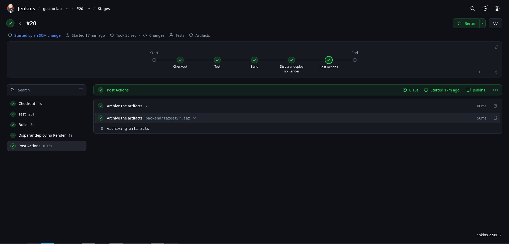
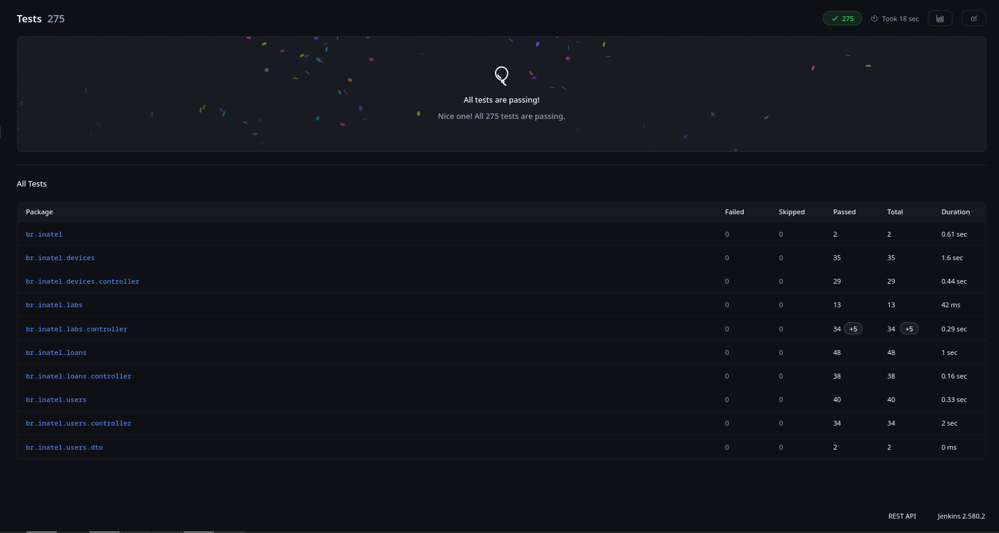

# Gestão de Laboratórios

Sistema web para controle centralizado de laboratórios acadêmicos. Cada laboratório possui administradores, participantes, projetos vinculados e seu próprio inventário de dispositivos. O sistema gerencia o cadastro de equipamentos, a associação a projetos e o fluxo de solicitação e devolução de empréstimos, garantindo rastreabilidade e impedindo alocações conflitantes.

Projeto acadêmico - Engenharia de Software (C14)

## Autores
- Giovana Franciele Gonçalves Leite (@GiovanaFrancieleGLeite)
- Igor Nogueira Olivio (@IgorNogueiraOlivio)
- Lucas Nolasco Ynoguti (@LucasYnoguti)
- Mauro Iwama (@Miwamma)
- Solange Ribeiro da Fonseca (@SolangeRibeiro)

## Funcionalidades

- Controle de acesso: perfis de Administrador e Participante, com permissões distintas.
- Gestão de laboratórios: administradores, participantes e inventário próprios para cada laboratório.
- Gestão de projetos: criação de projetos vinculados a laboratórios e associação de participantes e dispositivos.
- Inventário de dispositivos: cadastro de equipamentos por laboratório e controle dos status `AVAILABLE`, `BORROWED` e `MAINTENANCE`.
- Empréstimos e devoluções: solicitação de dispositivo vinculada a um projeto, validação de disponibilidade, aprovação ou rejeição pelo administrador e registro de devolução.
- Rastreabilidade e relatórios: histórico de movimentações, itens em atraso e alocações ativas por projeto.

## Tecnologias

- **Frontend**: React
- **Backend**: Java 21 + Spring Boot (Maven)
- **Banco**: SQLite
- **Testes**: JUnit + Mockito (backend), Jest + RTL (frontend)

## Estrutura do Repositório

Monorepo: backend, frontend, scripts de banco e CI/CD juntos.

Consulte o [índice da documentação](docs/README.md) para convenções de API e erros,
contratos por domínio e guias operacionais.

```
gestao-lab/
├── backend/
├── frontend/
├── docs/
└── README.md
```

## Estrutura do Backend

Arquitetura em camadas, organizada por domínio:

```
backend/src/main/java/br/inatel/
├── BackendApplication.java
├── users/     # Usuários & Acesso
├── labs/      # Laboratórios & Projetos
├── devices/   # Dispositivos
└── loans/     # Empréstimos & Relatórios
```

Cada domínio contém `controller/`, `service/`, `repository/`, `model/` e `dto/`.

## Como Executar

```bash
cd backend
./mvnw test
./mvnw spring-boot:run
```

## 🚀 Integração Contínua (CI / Jenkins)

O projeto conta com uma pipeline automatizada no **Jenkins** configurada via `Jenkinsfile` para garantir a qualidade do código a cada alteração.

### 🔄 Fluxo da Pipeline
A pipeline executa automaticamente as seguintes etapas:
1. **Checkout SCM**: Clona/atualiza o código do repositório Git.
2. **Checkout**: Prepara o ambiente de execução.
3. **Test**: Executa a suíte completa de testes automatizados.
4. **Build**: Compila o projeto.
5. **Post Actions**: Gera os relatórios de testes e cobertura de código.

### 📷 Evidências de Execução
| Pipeline Jenkins | Resultado dos Testes | Relatório JaCoCo |
| :---: | :---: | :---: |
|  |  |  |


## Requisitos Funcionais

| ID | Requisito |
|---|---|
| RF01 | O sistema deve permitir a autenticação de usuários. |
| RF02 | O sistema deve oferecer os perfis de Administrador e Participante, com permissões distintas. |
| RF03 | O sistema deve permitir o gerenciamento de laboratórios. |
| RF04 | O sistema deve permitir a criação de projetos vinculados a laboratórios. |
| RF05 | O sistema deve permitir a associação de participantes a projetos. |
| RF06 | O sistema deve permitir o cadastro de dispositivos por laboratório. |
| RF07 | O sistema deve controlar os status dos dispositivos: `AVAILABLE`, `BORROWED` e `MAINTENANCE`. |
| RF08 | O sistema deve permitir a solicitação de empréstimos de dispositivos vinculados a projetos. |
| RF09 | O sistema deve verificar a disponibilidade dos dispositivos antes de permitir um empréstimo. |
| RF10 | O sistema deve permitir a aprovação ou rejeição de solicitações pelo administrador. |
| RF11 | O sistema deve permitir o registro de devoluções de dispositivos. |
| RF12 | O sistema deve manter o histórico de movimentações dos dispositivos. |
| RF13 | O sistema deve disponibilizar relatórios de movimentações, itens em atraso e alocações ativas por projeto. |

## Requisitos Não Funcionais

| ID | Requisito |
|---|---|
| RNF01 | A aplicação deve possuir uma interface web desenvolvida em React. |
| RNF02 | O backend deve ser desenvolvido em Java 21 com Spring Boot. |
| RNF03 | Os dados da aplicação devem ser armazenados em SQLite. |
| RNF04 | O sistema deve restringir o acesso às funcionalidades conforme as permissões dos usuários. |
| RNF05 | O sistema deve preservar a integridade dos dados nas operações de empréstimo e devolução, evitando alocações conflitantes. |
| RNF06 | O backend deve possuir testes automatizados com JUnit e Mockito. |
| RNF07 | O frontend deve possuir testes automatizados com Jest e React Testing Library. |
| RNF08 | O código-fonte deve ser mantido em um repositório Git compartilhado, organizado como monorepo. |

## Metodologia Ágil e Gerenciamento do Projeto

O desenvolvimento do projeto é organizado utilizando Scrum. O Jira é utilizado para gerenciar o backlog, as histórias de usuário (*User Stories*), os critérios de aceite, as tarefas e o acompanhamento das sprints.
- [Backlog e sprints no Jira](https://solribeiro9147.atlassian.net/jira/software/projects/SCRUM/boards/1/backlog)
- [SCRUM-18 — Cadastro de laboratórios](https://solribeiro9147.atlassian.net/browse/SCRUM-18): história relacionada ao RF03 — gerenciamento de laboratórios.

## Refactors

| Causa | O que foi feito | Autor |
|---|---|---|
| Mensagem de credenciais inválidas repetida em `UserService.validateCredentials`. | Reutilizado o construtor sem argumentos de `InvalidCredentialsException`, preservando a mensagem existente. | @LucasYnoguti |
| Regra de expiração de sessões duplicada em `TokenService.issue` e `resolve`. | Centralizada em `Session.isExpiredAt(Instant)`, preservando a expiração no instante limite. | @LucasYnoguti |
## Documentação da API

- [Usuários e autenticação](docs/users.md)
- [Laboratórios](docs/labs.md)
